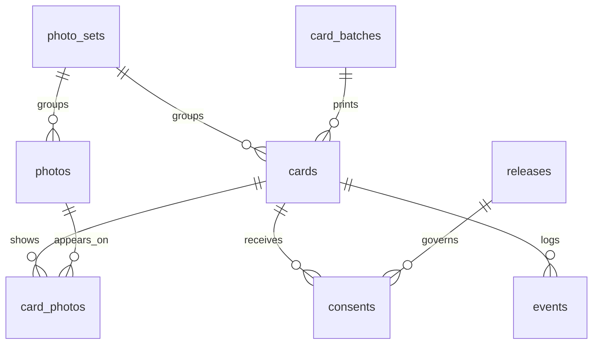
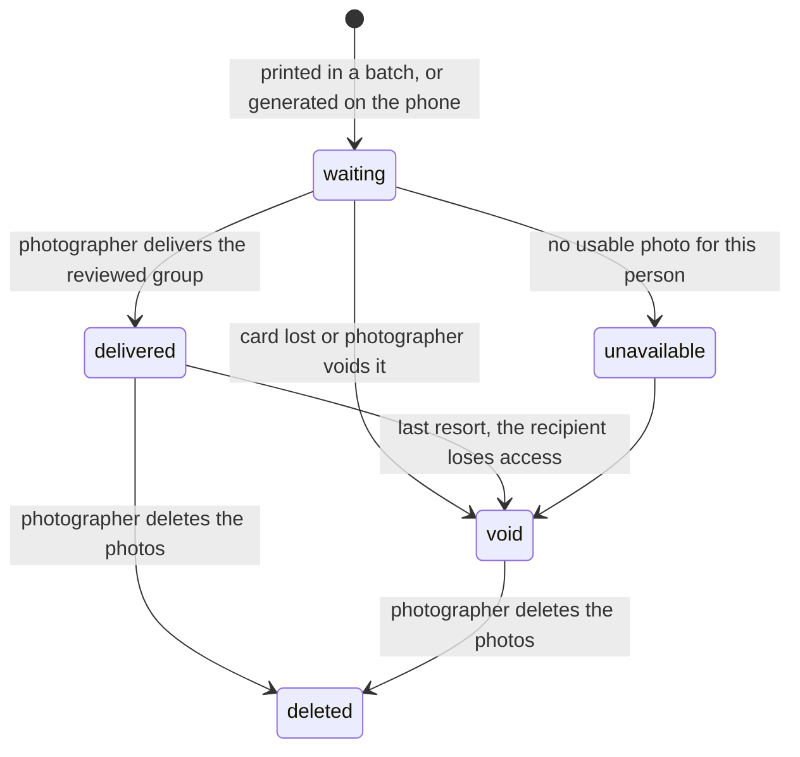

# People in Photographs: design

Project name: **People in Photographs**. Technical slug: `people-in-photos`.
A self-hosted web app that enables a street photographer to share the photos with people they 
photographed without exchange of contact info. The photographer could also ask for consent to 
publish if they choose to. 

One photographer behind one password; English and Turkish.

This document is a snapshot of the current design, not a history of it. Sections 1 to 10 describe
what exists unless a sentence says otherwise; sections 11 to 14 hold the plan, the assumptions,
the open decisions and the alternatives that were weighed. Section 15 says how to run it.

Confirmed scope: where a Set asks, the default permission is **as broad as a release can be**: any
use of the photos, in any medium and for any purpose, commercial use, advertising, stock licensing and
print sales included, worldwide and without time limit. The photographer narrows it on the profile
page to fit their country and local law; changing the wording creates a new release version and never widens a permission already given.

Contents

1. Purpose and principles
2. How it works
3. Key concepts
4. Data model
5. Matching uploaded photos to cards
6. Recipient pages and languages
7. Consent and release text
8. Privacy, security, retention
9. Self-hosting: one photographer per installation
10. Tech stack and architecture
11. Phases
12. Assumptions made
13. Open decisions
14. Ideas considered and not pursued
15. Running and testing

---

## 1. Purpose and principles

The photographer shoots with a DSLR on the street. When a close-up portrait is taken with permission,
one or both of these follow: the person asks for a copy, and the photographer wants consent before
publishing. The photo is not available at that moment; it is on a memory card and needs importing,
culling and editing. Delivery and consent are therefore asynchronous, days later.

Principles that shape every decision below:

- **No contact exchange on the street.** The person receives a claim ticket (a card), not a request
  for their email. Nothing is stored about them until they choose to act.
- **See first, then decide.** Consent is asked only after the person has seen the final photo.
- **Consent is the photographer's call.** Whether a photo taken in public needs the subject's
  consent depends on the country and the kind of photo, so each Set says whether its recipients are
  asked. When they are, one answer covers every photo on their card.
- **The gift is unconditional.** Downloading a photo never depends on granting consent.
- **The record must hold up years later.** Consent records are append-only, reference an immutable
  version of the release text, and are backed up daily.
- **Private by default.** Unguessable links, no search indexing, no subject accounts, deletion on
  request (the photographer deletes; section 8).
- **The DSLR workflow stays untouched.** Import, cull and edit in whatever tool; the app takes
  exported JPEGs.
- **One photographer per installation.** Whoever runs a copy is its only photographer, behind one
  password. There are no accounts to create and nothing to configure beyond a domain and a few
  secrets.

## 2. How it works

### On the street

The photographer carries printed cards, business-card size. Each card has a unique QR code, the
same code printed as text, the photographer's logo (or name) and a sentence of their own choosing,
written when the batch is generated, in whatever language they like (up to 120 characters; the
profile holds a default). A batch is 1 to 100 cards and downloads as
`photocards-<YYYYMMDD>-<label>.pdf`. After the portrait and the conversation, hand over a card, then take one frame of the card
with the DSLR: the "QR marker frame". It ties the card to the neighbouring shots in the camera
sequence, so nothing needs to be typed or synced.

No cards on hand: generate a single card from the **QR cards** page with an optional note ("blue
coat, outside the bookshop"), and let the person scan the QR from the screen. A virtual card is the
same thing as a printed card, only never printed. The card page shows the QR code until the card has
photos; after that it would only take up room.

### When the person scans

At `/c/<code>` they see a holding page in their own language: who photographed them and that the
photo is not ready yet. Nothing is asked of them. They keep the card and come back.

### At home

Import, cull, edit, export JPEGs as usual. In the dashboard, pick or create a **Set** (for example
"Frankfurt, summer 2026") and decide whether its recipients are asked for permission to post (a
checkbox when creating or editing the set, off by default), choose whether the QR marker frame comes before or after each person's
portraits, and drop the exported sequence onto it. The app decodes the QR frames, proposes which
photos belong to which card, and shows each group for review. The photographer ticks the photos that
really belong to that person and assigns them. (The dashboard says **Assign** and **Assigned**,
which is what the photographer is doing; the recipient pages, the code, the routes and the schema
say `deliver` and `delivered`, which is what the person receives.)

### When the person views

The delivered page is first a gift: the photos in a contact sheet, each with a download link for
the original file, exactly as the photographer uploaded it. When the set asks for permission, the
title is followed by two steps (download any photo, then answer one question) and the question
itself, "May I publish these photographs?", sits at the top of the page, open as soon as it loads:
where to find the photographer's work,
the full permission text one tap away, a name field, an adult confirmation, an optional
credit-and-note disclosure, "Allow me to publish all photos" and "Keep all photos private" (which
needs no name). There is no per-photo choice: the answer covers every photo on the card.
Afterwards the panel folds into the latest decision with its PDF record, a withdrawal link when
permission was given, and a "Change my decision" disclosure holding the same form. It opens again
by itself when photos are added to the card after a grant. They can return any time via the same
link to change their mind. To have the photos deleted they ask the photographer (section 8).

### The dashboard

The sidebar has six pages: **Photo sets** (the landing page, with counts and the set grid),
**QR cards** (three tabs: cards in use, cards opened before any photo arrived, and unused cards,
counted per batch and as single cards, with a purge that deletes them and any batch it empties;
batch and single-card generation), **Activity logs** (background jobs
and the event timeline),
**Profile & release** (public name, accounts, bio, the card logo (PNG or JPEG
up to 5 MB, stored as a PNG at most 1200px on a side) and default card sentence, and the release
text, versioned on every change), **How to use** (the workflow from the printed card to
the permission, step by step, with screenshots captured by `scripts/guide_screenshots.py` and an
animated picture of how marker frames split a camera sequence) and **FAQ**. The two reference
pages are prose in the templates, one branch per language, like the privacy page.

Clicking a photo on a set or card page opens a preview with the photo's card and decision, its
camera details in four tabs (Camera, Exposure, Image, Location; a tab without data is hidden, and the
chosen tab stays open while paging), the downloads, and the forms to fix a missed marker or attach
the photo to a card. The photographer's own downloads keep the camera filename (`IMG_4908.jpeg`,
`IMG_4908-display.jpeg`); recipients always get `people-photograph-<id>.jpg`. When the photo has GPS, the Location tab shows a small OpenStreetMap map with a
pin and a link to the full map; the tiles load only when that tab is opened.

## 3. Key concepts

| Concept | Meaning |
| --- | --- |
| **Photographer** | Whoever runs the installation; everything below is theirs. Their profile (public name, where to find their work, bio, card branding) is a single row, created at startup, and is what recipients see. They sign in with `PHOTOGRAPHER_PASSWORD`. |
| **Set** | A grouping the photographer chooses: a trip, a week, a walk. Holds cards and photos, and says whether its recipients are asked for permission. The people in a Set are unrelated to each other. Code name `PhotoSet`, table `photo_sets`, because `set` is a Python builtin and an SQL keyword. |
| **Card** | The central entity. A unique code that a person holds. Printed in a batch or generated on the phone (virtual). It is opened, receives photos, is delivered, and collects consents. There is deliberately no separate "encounter" table: a card *is* the encounter, before and after it happens. |
| **Photo** | An uploaded, exported JPEG owned by the photographer, in a Set. Stored as the original (the uploaded bytes, untouched) and display and thumbnail variants for viewing. A photo is on one card at most; people photographed together share one card. QR marker frames are photos with status `marker` and are never shown to recipients. |
| **Release** | The permission text a recipient agrees to: one text, in whatever languages the photographer writes it in. Every change on the profile page creates a new version; consents keep pointing at the version they were shown. |
| **Consent** | One submission by one person on one card: kind, attribution, signer, an optional email address the photographer may use by hand, the release version and language shown, and a snapshot of what was on screen, including every photo on the card with its file hashes. One decision covers all of them. A change of mind is a new consent that supersedes the old one. Records are labelled "Consent granted", "Consent denied" and "Consent withdrawn". |
| **Event** | Append-only audit row: opens, downloads, consents, deletions, reviews. |

## 4. Data model

### Entity relationships



`profile` (the photographer) and `jobs` stand alone: there is one of the first, and the second is
the worker's queue.

### Tables

Conventions: UUID primary keys, `created_at` everywhere, all timestamps UTC. Column defaults live
in the models (`app/models.py`), not in the database.

The database is one SQLite file (`DATABASE_PATH`, `/data/db/people.sqlite` in the container) and
the schema is one SQL file, `app/schema.sql`. The app and the worker both run it when they start
(`create_schema` in `app/db.py`): it is a single transaction of `CREATE … IF NOT EXISTS`
statements, so on an empty file it creates every table, index and trigger and on an existing one
it changes nothing. There are no migrations. Every installation starts from an empty database, so a
schema change is an edit to that file and to the models together; `tests/test_schema.py` compares
the two (tables, columns, types, nullability, unique constraints, foreign keys, indexes) so they
cannot drift apart unnoticed. An existing database does not pick up a changed column or
constraint.

SQLite specifics, in `app/db.py` and the models: WAL journaling, foreign keys switched on for every
connection, and every transaction opened with `BEGIN IMMEDIATE` so that it takes the single write
lock up front and waits for it (`busy_timeout`, 60 seconds) rather than failing halfway when the
other process wrote first. The price is that two transactions never overlap, so nothing slow runs
inside one: the upload route reads, hashes, QR-scans and stores every file before its first query,
the worker reads a photo, processes it with no transaction open and writes the result in a second
short one. For the same reason the signed-in check reads the profile in a session of its own.
Timestamps are kept as naive UTC text and handed back as aware UTC datetimes (`UTCDateTime`).

**profile**
- One row, created at startup (`app/main.py`) together with the first release
- `public_name`, `bio`
- `links` JSON: where people can find the photographer's work, `{"website": url, "instagram":
  handle, ...}` for a website and Instagram, Threads, X, Bluesky, Facebook and TikTok
  (`app/links.py`). The profile form has one field per entry and accepts a username, `@username`
  or a pasted profile URL; each is checked and stored in its plain form, empty ones are left out.
  The recipient page shows the filled ones as links; each decision record keeps them as text, one
  `Label: @handle (url)` line each
- `card_text` (the default sentence for a new batch), `logo_updated_at` (a logo PNG is stored)

**photo_sets**
- `name`, `location`, `description`, `archived`
- `request_consent`: whether the recipients of this set's cards are asked for permission (off by
  default). Switching it off later leaves recorded decisions standing and still changeable.

**card_batches**
- `label`, `quantity`, `base_url` (the public base URL baked into the QR codes), `card_text` (the
  sentence printed on this batch), `downloaded_at` (the final PDF is served once)

**cards**
- `code` unique (see "Codes" below), `kind` (`virtual` | `printed`)
- `batch_id`, `sequence` (printed cards only; the stack order), `photo_set_id` nullable
- `status` (`waiting` | `delivered` | `unavailable` | `void` | `deleted`)
- `notes`, `handed_out_at`, `first_opened_at`, `delivered_at`
- `revision`: bumped whenever the delivered photos change, so a consent form rendered against an
  older set of photos is rejected on submit

**photos**
- `photo_set_id`, `filename`, `size`, `width`, `height`, `captured_at`
- `original_sha256` (the uploaded bytes, stored untouched as the original that recipients
  download; unique, so deduplicated, including against photos deleted from a card, whose rows stay
  as the record; photos removed by the set cleanup lose their rows, so the same file can be
  uploaded again), `display_sha256` (the version shown on the recipient's page). A decision
  record's snapshot keeps both under the same names.
- `status` (`pending` | `ready` | `failed` | `marker` | `deleted`), `error`
- `exif` JSON: the camera details read at processing (`EXIF_TABS` in `app/services.py`,
  coordinates in decimal degrees), for the photographer's preview only; emptied when the photo is
  removed on request
- `upload_id`, `grouping_mode` (the camera sequence the photo last arrived in, for regrouping),
  `marker_card_id` (on marker frames: the card photographed)

**card_photos**
- `card_id`, `photo_id`, `delivered`
- unique `photo_id`: a photo is on one card at most; undelivered rows are the private proposal
  from QR grouping

**releases**
- `version` unique, `text` (one text, whatever languages it is written in), `sha256` (of the text)
- One row per version; saving the profile with changed text inserts the next version. Rows are
  immutable (see `events`).

**consents**
- `card_id`, `release_id`, `supersedes_id` nullable and unique
- `kind` (`grant` | `change` | `withdrawal` | `decline`), `locale`
- `attribution` (`anonymous` | `credit` | `no_preference`), `credit_name`, `signer_name`, `signer_email`, `note`
- `ip`, `user_agent`
- `snapshot` JSON: the photographer's public name and accounts, the release version, hash and the
  text shown, every photo on the card with filename, display and original hashes and `allowed`
  (all true for a grant, all false for a decline or withdrawal), and the
  connection details (accepted languages, browser client hints) shown on the record

**events**
- `card_id` nullable, `type`, `actor` (`subject` | `photographer` | `system`), `payload` JSON
- Types in use: `link_opened`, `photos_grouped_from_qr`, `marker_assigned`, `photo_attached_by_hand`,
  `photo_group_confirmed`, `photo_downloaded`, `consent_grant`,
  `consent_change`, `consent_decline`, `consent_withdrawal`, `photos_deleted`,
  `unassigned_photos_deleted`,
  `card_void`, `card_unavailable`
- Insert-only. `app/schema.sql` adds `BEFORE UPDATE` and `BEFORE DELETE` triggers on `events`,
  `releases` and `consents` that abort the statement; a test proves rewriting is blocked. SQLite has
  no roles, so the protection is the triggers alone: anyone with the file can drop them, which on a
  single-owner installation is the owner.

**jobs**
- DB-backed queue processed by the worker: `type`, `payload`, `status`, `attempts`, `run_after`,
  `locked_at`, `error`
- Job types: `process_photo` (keeps the original, renders the variants, reads the camera details), `purge_photo` (erases a photo's
  files; clears its camera details when the row stays as the record)
- A job is tried three times, waiting 10 seconds times the attempt number in between, then marked
  `failed` for a manual retry; a job left `running` for 15 minutes (a worker that died) is picked
  up again. A failed `process_photo` also marks its photo `failed` with the error.

### Codes

- 16 characters of Crockford base32, 80 bits of randomness, printed in four groups: `7K3M-9X2B-04HD-ZP8R`.
- The QR encodes `<PUBLIC_BASE_URL>/c/7K3M9X2B04HDZP8R`. Manual entry accepts dashes, spaces and
  lowercase, and Crockford's ambiguity mapping (O to 0, I and L to 1).
- Codes are domain-independent. The domain can be chosen later; only the printed URL depends on it.
  A final card batch PDF is refused while the base URL is localhost; a watermarked preview is allowed.
- The final batch PDF downloads once per batch. Reprinting a sheet is the one realistic way to hand
  the same code to two people, so the batch records the download and refuses a second one. The
  preview is unlimited. Random collisions are not a concern at 80 bits.

### Card lifecycle



Deleting needs at least one delivered photo, so it is offered on a delivered card and on a voided
one that had been delivered. *No photo available* is offered only on a waiting card, and a void
card stays void.

Derived, not stored as status: *opened* (`first_opened_at` set), the proposal (undelivered
`card_photos` rows), and the permission summary per photo (see section 7).

## 5. Matching uploaded photos to cards

The photographer uploads the complete camera sequence into a Set and chooses one of two explicit
grouping modes before upload:

1. **Portraits, then QR card**: each recognized QR marker closes the group of photographs immediately
   before it. This supports unplanned street encounters where someone asks for a copy after being
   photographed.
2. **QR card, then portraits**: each recognized QR marker opens the group of photographs immediately
   after it. This supports planned portrait sessions and events.

Files are processed in natural filename order. Each file is at most 25 MB and must be a JPEG; the
browser leaves out anything else and the set page names what it skipped (phone pickers ignore the
`accept` filter). Uploading to an archived set is refused. QR codes are read with `zbarimg`, with
every linear barcode type switched off, on a 600px greyscale copy first and on the original only
when that finds nothing. A frame showing two different card codes is refused, as is a file already
uploaded to another set or removed on request. Only payloads
resolving to one of the installation's cards act as markers. A detected card joins the Set
automatically, the non-marker frames in its group are attached as a private proposal, and the QR
marker frame is kept with status `marker`, unprocessed and omitted from the gallery. Frames outside
a QR boundary remain private and unassigned.

Every photo remembers the upload it last arrived in and the grouping mode chosen for it. When the
scanner misses a card frame (glare, motion blur, a card too small in the frame), that frame sits in
the gallery like any other photo and the neighbouring groups come out wrong. The photographer opens
the photo's preview, types the code printed on the card, and the frame becomes that card's marker:
its upload is grouped again from its marker frames, the proposals of the cards named in that upload
are redrawn, and delivered links, other uploads and cards without a marker there are left as they
were. A photo that was already delivered cannot become a marker. A card that already has photos or a
marker frame cannot be moved to another set.

A photo the scan left out (missed on the day, exported later, or outside every marker's reach) is
put on a card by hand from the same preview: the photographer picks one of the set's open cards
and the photo joins that card's proposed group as the same undelivered link a scan makes
(`attach_photo` in `app/services.py`). A proposal on another card moves, so a photo on the wrong
card is corrected; a delivered photo stays with the person it was given to. Regrouping an upload
follows the same rule and leaves a photo that is on another card where it is. Nothing reaches the
recipient until the group is reviewed and delivered.

The photographer reviews each proposed group, checks the individual photographs that really belong
to that card, and explicitly delivers only those selections. Checkboxes start empty. Unchecked
candidates return to the Set as private, unassigned photographs. Nothing becomes visible through a
recipient link merely because a QR code was detected. Manual batch-to-Set assignment is not part of
the workflow; batch names exist for generation history and support.

A detected group can instead be resolved with **Do not assign photos**. That closes the card as
`unavailable` and releases every candidate in the group as unassigned. Once every detected group has
either a delivered photograph or that explicit no-assignment decision, the Set offers a bulk cleanup
that permanently purges all unassigned photos, rows and files: nothing ever referred to them, and the
same files may be uploaded again. The product is a delivery and consent workflow, not long-term photo
storage.

## 6. Recipient pages and languages

Everything under `/c/` is public, server-rendered, a few lines of JavaScript that the page works
without, fast on a slow cellular connection, and marked `noindex`. No account. Two cookies: the
language preference and a CSRF token.

The language is part of the URL: every page lives under `/en/` or `/tr/`, recipient pages and
dashboard alike (`/tr/c/<code>`, `/en/dashboard/sets`). A flag menu at the top of every page
switches the prefix and keeps the rest of the path. A URL without a prefix, such as the
`/c/<code>` inside a QR code or a typed `/login`, redirects to the visitor's language, chosen like
this:

1. The language remembered in the cookie, set whenever a prefixed page is opened
2. The browser's `Accept-Language`, if it names a supported language
3. `DEFAULT_LOCALE` (`en`)

Static files, media and the health endpoint carry no prefix. Form posts are accepted with or
without one; redirects after a post keep the language of the page that posted.

Both languages ship with a full catalogue (`app/locales/en.json`, `app/locales/tr.json`) and a test
fails when their key sets differ. Adding a language means adding those two things.

The release text is one text per version, not one per language: the photographer writes whatever
languages they want in a single box, and the recipient is shown all of it. Printed cards carry the photographer's own sentence, in whatever language they
chose; the QR code needs no language.

Pages:

- **Holding page** (`waiting`): photographer's public name and bio, "your photos are on their way",
  nothing to fill in.
- **Delivered page** (`delivered`): described in section 2. Downloads are always the original
  file; the display version is only shown on the page, and the media route refuses it as a
  download. Without a permission request the page is the photos and their downloads, nothing else.
- **After submitting**: the same page with a confirmation, the latest decision, its PDF record,
  "Withdraw my permission" when permission was given, and the form folded under "Change my
  decision".
- **No photo available** and **deleted**: a short explanation; the deleted page keeps the PDF link.
- **Unknown code**: generic not-found with a manual entry field; no hint about whether a code exists.

## 7. Consent and release text

Consent is asked only on cards of a Set with `request_consent` on; elsewhere the recipient page asks
nothing, and the route refuses a first decision. The question is one thing: may the photographer publish
and use the photos on the card, in any form: online, in print and commercially, on the terms of
the release text. The answer covers every photo the card
shows at that moment; there is no per-photo choice. Where to find the photographer's work is shown
beside the question so the person knows where to look; it does not limit where the photos may
appear. Attribution is `credit` (with a name), `anonymous` (do not name or tag me, the default), or
`no_preference`. The exact scope is the release text. Editing the release text never extends permissions already recorded under an earlier
version.

Granting needs a typed full name and the confirmation "I am the person
pictured and I am 18 or older". Declining needs nothing else: "Keep all photos private" records a
`decline` without a name. The form is bound to a signed token covering the card, its photo revision,
the release version, the previous decision and the photographer's profile; if any of those changed
before submit, the page asks for a reload rather than recording a decision against stale context.
A second signed token binds the form to the language its release text was shown in.
Duplicate submissions of the same form are rejected.

The record stores the release version and language shown, the release hash, every photo with its
display and original hashes and whether it was allowed, the timestamp, IP, user agent, accepted
languages and browser client hints. This is a simple electronic signature. Whether it satisfies a given
jurisdiction is an open decision (section 13), not a claim the app makes.

The record belongs to the photographer, so its labels follow whoever is reading it: the dashboard's
record page and PDF are in the language the photographer uses the dashboard in, and the copy a
recipient downloads from their card page is in the language they read that page in. Labels come
from the language catalogues, never side by side in several languages, so adding a language adds
no code. What was entered or shown (names, note, credit, the release text) appears as recorded,
and the language the decision was made in stays a field of the record.

The PDF record shows a small thumbnail beside each photo's hashes, so the photos can be recognised
at a glance. It is drawn from the stored display image, and only while that image still matches the
recorded hash: a photo deleted or replaced since leaves the space empty rather than show a picture
the person never decided on.

Changing a decision creates a new consent row of kind `change` or `withdrawal` that supersedes the
previous one; the timeline and the Activity logs page show it. Withdrawal removes the app's approval
indicator. Taking down posts already made is the photographer's manual job: the app does not log
posts (section 14). The release text says plainly that withdrawal applies going forward and
cannot guarantee deletion of copies in other people's hands.

Per photo, the photographer's dashboard derives one of five states (`photo_permission` in
`app/services.py`): **ready to publish** (its card has a current grant covering this exact
display version), **awaiting decision** (the set asks, and the card has no decision yet or its
grant was given before this photo or version was added), **permission not asked** (the set does
not ask and no grant covers it), **needs review** (not processed, or not yet delivered), or
**keep private** (declined or withdrawn). A newly
uploaded or replaced image never inherits an earlier grant; the hashes in the record must match. On
the recipient page such a photo reopens the question, and the new answer again covers all photos.
A decline or withdrawal covers photos added later too, and does not reopen the question.

Release text is one document per installation with a version per change. The shipped default
has not been legally reviewed (section 13); the profile page says it is a starting point to adapt,
not legal advice. No page, PDF or default text calls the installation a demo; only the dashboard's
top bar does, and only in development. Minors: there is no guardian path. The
recipient confirms they are an adult; anyone under 18 is asked to contact the photographer.

## 8. Privacy, security, retention

- **Access**: a card URL is a bearer token. 80 bits of randomness plus per-IP rate limits: card pages
  180 a minute, manual code entry 12 a minute, login 8 a minute,
  decisions 30 in five minutes. Photographers can void a card;
  voiding a delivered card is a last resort because the recipient loses access too.
- **Images**: served through the app from short-lived signed URLs (15 minutes) bound to the photo,
  variant and card, never from stable public paths. Drafts and originals cannot be reached
  from a recipient link unless delivered, and a test proves it.
- **Headers**: `X-Robots-Tag: noindex, nofollow` and `robots.txt` disallow everywhere;
  `Referrer-Policy: no-referrer`; `Cache-Control: private, no-store`;
  `X-Content-Type-Options: nosniff`; a strict Content Security Policy with
  `frame-ancestors 'none'`, whose only third-party source is OpenStreetMap's map tiles (`img-src
  https://tile.openstreetmap.org`), loaded in the photographer's preview when the Location tab is
  opened and sent with the installation's origin as the referrer, as OSM's tile policy asks;
  `Permissions-Policy` denying camera, microphone and location.
- **Metadata**: the original is kept exactly as uploaded, metadata included (camera, exposure,
  GPS, serial numbers, comments), and it is the file recipients download: the photographer's
  original is the gift. The display and thumbnail versions, the only ones shown on a page, are
  re-encoded by Pillow from the primary frame with no metadata but the photographer's public name as
  Artist and Copyright. Tests check both. The worker also reads the camera details into
  `photos.exif` for the photographer's preview; the privacy page tells recipients what the download
  carries, and deleting a card's photos clears the details with the files.
- **Data minimisation**: no subject accounts. An email address is optional, asked only on the consent
  form, and never used by the service to send anything; IP and user agent are stored on consent rows only. Recipient pages show "Photo 1", never the photographer's filenames.
- **Deletion**: a recipient who wants their photos deleted asks the photographer; the recipient
  pages offer no request of their own, and the privacy page says to contact the photographer. On
  the card page, **Delete the photos** erases every delivered photo on the card: the files and
  camera details go (`purge_photo`), the rows stay as the record (so the same files are refused at
  upload and decision PDFs keep their hashes), undelivered proposals return to the set, and the card
  becomes `deleted`, which closes the recipient's gallery and shows them that the photos were
  deleted, with the PDF record still linked. Nothing is kept for finding the photographer's own copies: the card page names the
  camera filenames before the photos are deleted. Consent rows are kept as the record of what
  happened; identity redaction is not yet implemented and the privacy page says so.
- **Retention defaults**: nothing expires automatically yet.
- **Backups**: the app makes none. Decision PDFs are not stored: they are rendered from the
  consent row on every request, so the database and the stored photographs are the whole state.
- **Web hygiene**: CSRF token cookie plus form field, checked together with Fetch Metadata or the
  `Origin` header; `SameSite=Strict` session cookie valid twelve hours; HTTPS via Caddy, which obtains and renews the certificate itself (section 15).
- **Sign-in**: one password, `PHOTOGRAPHER_PASSWORD`, compared in constant time. Outside
  development the app refuses to start with the shipped default or anything under 12 characters.
  The session cookie holds a signed fingerprint of the password, so changing the password signs
  every browser out. Every dashboard route goes through one dependency (`require_photographer`
  in `app/web.py`) that checks the cookie and loads the profile.
  The language prefix is handled by one ASGI middleware in `app/i18n.py`; routes and templates never
  see it, and template links use the `base` helper to carry it.

## 9. Self-hosting: one photographer per installation

Anyone can run their own copy: clone the repository, set a handful of values in `.env`, run
`docker compose up -d --build`, and point a domain at the server (section 15). The installation
belongs to one photographer. There are no accounts, sign-up, roles or operator pages, and no
third-party identity service: the dashboard is behind a single password, and recipients never sign
in at all (the card code is their credential).

What follows from that:

- No row carries an owner. Queries need no scoping, storage keys are `photos/<photo_id>/…` and
  `logo.png`, and media tokens name only the photo, variant and card.
- The profile is one row, made at startup with the default release text; the photographer edits it
  on the Profile & release page.
- Codes only have to be unique within the installation, and the printed URL is the installation's
  own `PUBLIC_BASE_URL`.
- Background work is visible to the photographer directly: the Activity logs page lists queued,
  running and failed jobs with a retry.
- Every install is a fresh install. The schema comes from `app/schema.sql` on first start and there
  is no upgrade path for an existing database (section 4).

Of the two shapes, one service hosting many photographers and one installation per photographer,
we went with the second. A shared service needs accounts, a third-party identity provider,
operator roles and pages, owner scoping on every row and query, and migrations for a database
that outlives every release; one installation per photographer needs none of that, keeps each
photographer's subjects' data on infrastructure that photographer controls, and leaves one
password as the whole of sign-in. Two photographers run two copies.

## 10. Tech stack and architecture

| Layer | Choice | Notes |
| --- | --- | --- |
| Web framework | FastAPI on Starlette 1.x, Jinja2 templates | Server-rendered pages. One small vanilla script (`app/static/app.js`) for dialogs, drag-and-drop upload and the processing auto-refresh; every page works without it. |
| Database | SQLite (WAL), SQLAlchemy 2 | One file on the data volume, shared by the app and the worker. Schema from `app/schema.sql`, no migrations; consents, releases and events are append-only by trigger (section 4). |
| Storage | Local disk under `STORAGE_ROOT` by default; Cloudflare R2 through boto3 when `STORAGE_BACKEND=r2` | Local disk on the `data` volume is the default; R2 is one environment change for an installation that wants its photographs off the server. Keys `photos/<photo_id>/{original,display,thumb}.jpg` and `logo.png`; the upload is stored once, as `original`, before its row exists, and the worker adds the other two. A local write goes to a scratch file renamed into place, so a reader never sees half a file. Uploads and downloads go through the app (R2 objects streamed with their length), so access is checked on every request and a revoked card stops working at once. The worker copies the original into a scratch directory for exiftool and Pillow and writes the variants back. |
| Look | Archivo (self-hosted under `app/static/fonts/`, SIL OFL), inline Lucide icons from `app/icons.py`, the Modernist tokens in `app/static/app.css` | One typeface at a 16px body size, a near-white ground, one red accent for the primary action and the active state, 2px rules and zero radius. The recipient pages make no third-party request, so the font files ship with the app. |
| Images | Pillow | Variants: thumb 480px, display 2048px long edge, quality 85, converted to sRGB. JPEG only, up to 36 megapixels (larger is refused as a decompression bomb); MPO phone files use the primary frame. |
| Camera details | exiftool | Installed in the image. Reads the preview's camera details (`-json -coordFormat %.6f`); files are never rewritten by it (section 8). |
| QR decode | zbarimg | Reads marker frames at upload, on a reduced copy first. |
| QR generate | segno | SVG for the card page (until the card has photos) and the batch PDF, PNG for tests. |
| Map | OpenStreetMap tiles | The preview's Location tab: the 3×3 zoom-15 tiles around the spot (`exif_map` in `app/services.py`), placed by `app/static/app.js` because the CSP forbids inline styles. No library, no API key. |
| PDF | reportlab with DejaVu Sans | Card batch sheets and decision records. Pure Python, and the fonts ship in `app/fonts/` (Bitstream Vera licence), so PDFs render identically wherever the app runs; DejaVu covers Turkish glyphs. |
| i18n | Flat JSON catalogues (`app/locales`) with a `t()` template helper; language prefix in every page URL | No build step. A test fails when the two languages' key sets differ. |
| Auth | One password | `PHOTOGRAPHER_PASSWORD`; a signed, twelve-hour, `SameSite=Strict` session cookie bound to the password (section 8). |
| Email | None | The service sends no email. A recipient may leave an address on the consent form for the photographer to use by hand. |
| Rate limiting | In-app per-IP token bucket | Single instance, so in-memory is fine. |
| Background work | Worker process, same image, `jobs` table | Photo processing and purges; three attempts per job (section 4). A heartbeat file backs the worker's Compose health check. No Redis. |
| Deploy | Docker Compose: app, worker, caddy; the test profile adds tests | Caddy is the only thing published: 127.0.0.1:8010 locally, 80 and 443 on a server, with automatic HTTPS for `SITE_ADDRESS` (section 15). One `data` volume holds the database and the photographs. |
| Tests and tooling | pytest, ruff, pyright, pip-audit, Playwright, moto | The test command runs ruff, pyright, pip-audit over both lock files (it needs network access, and fails on any pinned version with a known, fixed vulnerability), then pytest (the workflow, storage and schema tests), each on a new SQLite file built from `app/schema.sql`; the R2 backend is tested against moto. The fixture refuses to run unless the database is under `/tmp` and storage is local, so a test run cannot wipe real data. A Chromium smoke script drives the full loop through Caddy (section 15). |

Alternatives weighed: Django (the free admin is attractive, but a single-photographer app has
little to administer), a TypeScript stack (fine, but more assembly for uploads, jobs and image
work), htmx (nothing on the pages needs it). Of SQLite and PostgreSQL, we went with SQLite: one
photographer per installation never needs concurrent writers beyond the app and the worker, and
SQLite takes a database container, its passwords and its dump tooling out of every install. The
cost is one writer at a time, which the short transactions in section 4 are built around.

Configuration is by environment (`.env`, see `.env.example`): `APP_ENV`, `PUBLIC_BASE_URL`,
`DATABASE_PATH`, `STORAGE_BACKEND`, `STORAGE_ROOT`, `R2_ACCOUNT_ID`,
`R2_ACCESS_KEY_ID`, `R2_SECRET_ACCESS_KEY`, `R2_BUCKET`, `PHOTOGRAPHER_PASSWORD`,
`SECRET_KEY`, `DEFAULT_LOCALE`, `CONTACT_EMAIL` (optional; linked from the footer of the public
pages when set). Compose reads three more for Caddy: `SITE_ADDRESS`, `HTTP_BIND`, `HTTPS_BIND`.
Nothing is configured ahead of a feature. `STORAGE_BACKEND=r2` refuses to start without all four `R2_` values. Production settings (`APP_ENV`
other than `development`)
require HTTPS in the base URL, a strong secret key and a photographer password of at least 12
characters other than the default, and mark
cookies Secure. Development runs at localhost; the app refuses to render a final
card batch PDF while the base URL is localhost, so no cards get printed with the wrong domain.
In development the dashboard's top bar carries a "local demo" badge.

Errors: every refused request is logged with the same localized message the person sees, and an
unexpected exception shows a plain error page while the traceback goes to the log (`app/main.py`).

### Code layout

- `app/main.py`: assembles the application: lifespan, static files, middleware, error page, routers.
- `app/web.py`: what every route needs: `render`, `go` (language-aware redirect), form parsing with
  CSRF, the signed-in session and its dependency, card lookup by code, PDF responses.
- `app/routes/`: one module per area, each an `APIRouter`: `site` (home, code entry, sign-in,
  privacy), `sets`, `cards`, `profile`, `activity`,
  `reference` (how to use, FAQ), `recipient` (everything under `/c/<code>`), `media` (photo
  files behind signed URLs, for recipients and the photographer).
- `app/services.py`: domain rules shared by routes and the worker: row lookups, the profile, release
  versions, delivery links, photo permission, purges, the job queue, events.
- `app/links.py`: the profile's website and social network fields: reading what was typed, building
  the links.
- `app/i18n.py`: catalogues, language negotiation, the URL-prefix middleware, localized errors.
- `app/timeline.py`: turns events into the one-sentence-per-event log of the Activity logs and card
  pages, grouped by day, tinted and linked to the card, set or decision behind each line.
- `app/models.py`, `app/schema.sql`, `app/db.py`, `app/config.py`: tables, the schema, the SQLite
  connection, settings.
- `app/security.py`, `app/storage.py`, `app/matching.py`, `app/pdfs.py`, `app/worker.py`,
  `app/icons.py`: codes, signing, CSRF and rate limits, file keys, QR scanning, PDFs, the background
  loop, the inline icons.
- `scripts/`: the two Chromium scripts and what they share (`browser_common.py`: the port forward
  and the sample portraits and QR frames).

## 11. Phases

### Phases 0 and 1: foundations and the MVP (built, pending a field trial)

Everything sections 1 to 10 describe.

Done when: a batch has been printed, handed out over a real week of shooting, photos delivered,
consents received in both languages, and a decision PDF exported, with no step that needed a
workaround. That trial has not happened yet.

### Phase 2: make the workflow genuinely good

- Tap-to-enlarge on the decision page, so the contact sheet does not cost full-size viewing.
- Phone "log a card": scan a printed card at handoff, record time, place and note.
- Suggest a Set when a blank card is first opened inside a Set's date range.
- Home-screen install for the phone page; a small offline pool of pre-generated virtual codes.
- "Download all" zip for recipients; consent export as CSV per Set; light stats (open rate,
  decision rate).
- Card design options and a print-shop-ready PDF variant (one unique back per card).
- Automatic expiry of never-opened virtual cards; identity redaction on consent rows.

Done when: a week of shooting takes minutes, not an evening, to deliver.

### Phase 3: ready for anyone to self-host

In place: an MIT licence, a README written for a stranger, and section 15's path from clone to a
working domain. To do: release notes, lawyer-reviewed default release texts for the target
jurisdictions, and an upgrade story for when the schema changes after people are running it
(section 13).

### Phase 4: integrations, as demand shows

Lightroom publish plugin or a watch-folder uploader; NFC chips in cards; ordering printed cards
from within the app.

## 12. Assumptions made

Recorded so they can be challenged.

- The Card is the central entity; there is no separate encounter table. A printed card is a
  pre-generated waiting card. This unifies the printed and phone flows into one code path.
- The default release text is deliberately as loose as possible (any use, commercial included,
  no time limit, no payment) and names those uses explicitly, so a grant under it is clear about
  what it covers. Restricting it to what the photographer's country and local law allow or require
  is the photographer's job on the profile page. The recipient page's explanation says the same
  in short and points to the full text.
- A new Set does not ask for permission until the photographer ticks it: in many places a photo
  taken in public needs no consent, and the photographer knows where they work.
- Once a person has granted consent, the name and credit fields come back prefilled, so a later
  change starts from what is in force; nothing is prefilled after a decline or withdrawal.
- Recipients download the original file, metadata included; no watermarking.
- Downloads never depend on consent.
- IP addresses and user agents are kept on consent rows only.
- Nothing expires automatically.
- Both the dashboard and the recipient pages shipped bilingual. The Turkish strings are first drafts
  by the implementer, not a translator.
- The fallback language when the browser offers neither Turkish nor English is English.
- Uploads go through the app, also with R2 storage, so every file is checked and scanned on the
  way in.
- One card per encounter, also for a group. People photographed together share one card: anyone
  with the link sees and downloads the photos. Where the set asks for permission, the card still
  records one decision, so for a group portrait the photographer judges whether one person's
  answer is enough. Giving one photo to several cards was considered and dropped as more machinery
  than a shared link needs.

## 13. Open decisions

- **Jurisdictions and governing language.** Turkey and Germany came up. Germany's right to one's own
  image (KUG) and the EU GDPR, and Turkey's KVKK, all bear on the release text and deletion duties.
  Which language prevails on conflict needs a decision, and the default text needs legal review
  before Phase 3.
- **Guardian policy.** There is no path for minors beyond asking them to contact the photographer;
  what the app should collect, if anything, for a guardian's decision is unsettled.
- **Retention periods and legal basis.** The privacy page says what is stored and that it stays
  until the photographer removes it, and links `CONTACT_EMAIL` when set; it names no retention
  period or legal basis, which depend on the photographer's country.
- **Default breadth.** The default text is as broad as possible on purpose; whether that holds
  up in a given country, especially for commercial use of a likeness, is part of the legal review.
- **Editing tool.** Lightroom would make the Phase 4 publish plugin worthwhile; anything else points
  at the watch-folder uploader.
- **Schema upgrades.** There are none: every installation is a fresh install. Once other people
  run copies with real data, a schema change needs a way to reach their databases, whether
  versioned SQL files or a migration tool.

## 14. Ideas considered and not pursued

- Native mobile app: no need; a home-screen web page covers QR generation and card logging. Revisit
  only for NFC writing or heavy offline use.
- Face matching to auto-group frames of the same person: clever, but the QR marker frame solves the
  problem without processing biometric data.
- Watermarks on delivered photos: hostile to a gift.
- Subject accounts or logins: friction with no benefit; the card code is the credential.
- Tamper-evident hash chain over the events table: on a single-owner installation the only person
  who could rewrite the table is the owner the chain would be guarding against (section 4).
- Phone-typed subject email at handoff: kept only as a rare fallback via the card note; the card
  exists to avoid this.
- Automatic email (opt-in "notify me" on the holding page, an alert to the photographer on every
  decision, a mail server to run): the dashboard already shows every decision, the holding page
  works by coming back to the card, and a second channel is more machinery than the workflow
  needs. The consent form keeps an optional address for the photographer to use by hand.
- One tall photo per row on the decision page: of that and a contact sheet, we went with the
  contact sheet (section 2), because one photo per row pushes the decision below the fold and
  makes the download button outrank the choice.
- A publication log (the photographer records each social post against a photo, and withdrawal or
  deletion moves those posts to a review list), with per-photo review flags: it is bookkeeping the
  photographer would have to keep in step with their social accounts by hand. Posts are not
  tracked; the photographer sees each withdrawal on the Activity logs page and takes posts down
  by hand.
- Per-photo consent (the recipient ticks which photos may be posted): of that and one answer for
  the whole card, we went with one answer, because the photos on a card are one encounter, the
  question stays a single tap at the top of the page, and the record stays simple to read.
- Consent on every card: whether it is needed differs by country and kind of photo, so it is a
  per-Set choice of the photographer rather than a rule of the app.
- Stripping metadata from the recipient's download, or giving a smaller display copy: the
  recipient gets the photographer's original as it left the camera and editor. Only the versions
  shown on a page are re-encoded without metadata. The photographer's preview reads the same
  camera details; the map loads from OpenStreetMap only when the Location tab is opened.

## 15. Running and testing

Copy `.env.example` to `.env`, then:

```
docker compose up -d --build
```

The dashboard is at http://localhost:8010/login (password `PHOTOGRAPHER_PASSWORD`, default
`people-local`). On its first start the app creates the database from `app/schema.sql` and the
profile. A changed column or constraint in `schema.sql` reaches only a new database:
`docker compose down -v` removes the volumes (and every photo and decision with them) so the next
`up` starts fresh. Rebuild after code changes; the containers copy the repository at build time.

The landing page shows a random photo from `app/static/home/` on each visit. Replace the two
sample images there with your own (JPEG, PNG or WebP) and rebuild. The samples are AI-generated and
show no real people.

Lint, type check, the dependency audit and tests run in the `test` profile against a throwaway
database and local storage under `/tmp/test` inside the container, whatever `.env` says. The audit
needs network access; when it reports a vulnerability, bump that pin in the lock file:

```
docker compose --profile test run --rm --build tests
```

The Chromium smoke script drives the whole loop against the running stack, from sign-in through
QR grouping, delivery, a Turkish decision, the PDF record and withdrawal, and writes screenshots
and `result.json` to `output/browser`:

```
docker compose --profile test run --rm --build tests python scripts/browser_smoke.py
```

It leaves clearly labelled demo data ("Demo walk · <timestamp>") in the local database. The
browser inside the container reaches the stack at its public origin through an in-process port
forward; the reasons are in the script's docstring.

The screenshots on the **How to use** page come from a second Chromium script. It starts its own
app and worker inside the test container, on the throwaway test database and with the password
login, walks one demo encounter through the workflow and photographs each page in both
languages straight into `app/static/guide/<lang>/`, which the test profile mounts from the host.
Run it when a page the guide shows has changed, then rebuild:

```
docker compose --profile test run --rm --build tests python scripts/guide_screenshots.py
```

### Running it on your own server

Any machine with Docker and ports 80 and 443 reachable from the internet will do.

1. Point a domain's DNS (an `A`, and `AAAA` if the server has IPv6) at the server.
2. Clone the repository, copy `.env.example` to `.env`, and set `APP_ENV=production`,
   `PUBLIC_BASE_URL=https://<domain>` (exactly the public origin: the CSRF check compares against it
   and the printed QR codes embed it), `SITE_ADDRESS=<domain>`, `HTTP_BIND=80`, `HTTPS_BIND=443`,
   a random `SECRET_KEY` of 32+ characters (`openssl rand -hex 32`) and a `PHOTOGRAPHER_PASSWORD`
   of at least 12 characters. The app refuses to start in production without these.
3. `docker compose up -d --build`. Caddy obtains the HTTPS certificate on the first request and
   renews it by itself; check with `curl -sI https://<domain>/health`.
4. Updating is `git pull` and the same `docker compose up -d --build`.
5. If another proxy sits in front of Caddy (a CDN such as Cloudflare, a load balancer), add it to
   Caddy's `trusted_proxies` in `docker/Caddyfile`. Otherwise Caddy hands the app the proxy's
   address for every visitor, and they all share one rate limit, the eight sign-in attempts a
   minute included.
6. The app makes no backups. The database and, with local storage, the photographs share the
   `data` volume, so a lost server loses both together unless you copy it elsewhere yourself.
